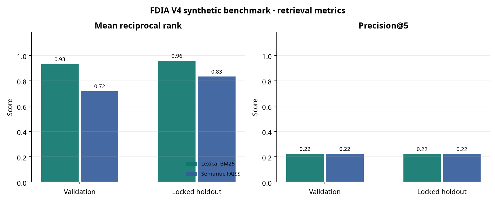

# FDIA V4 — Final validation report

**Run date:** 2026-11-10  
**Code/configuration:** frozen after development and validation testing; holdout run once using explicit opt-in.  
**Scope:** software-behavior validation on synthetic fixtures only—not validation of performance on actual annual reports.

## Executive conclusion

The deterministic lexical baseline and semantic-retrieval baseline each achieved 100% on the scored factual, numeric-token, citation-span, abstention, adversarial-refusal and repeated-consistency cases in the final 40-case validation split and the locked 40-case holdout. The lexical baseline returned a higher mean reciprocal rank (MRR) than semantic retrieval on both splits (0.931 vs 0.718 on validation; 0.958 vs 0.833 on holdout). Both configurations had low Precision@5 (~0.22) despite 1.00 Recall@5, showing substantial irrelevant top-five retrieval and limited demonstrated benefit from the embedding model on this very small corpus. Results **must not be interpreted as real-world accuracy or evidence of safe deployment**: the two included financial reports, expected outputs and benchmark labels are synthetic and the full review queue is pending independent human adjudication.

The two NVIDIA NIM variants were not executed because `NVIDIA_API_KEY` was not configured. The NIM claim-gate was unit-tested with a mocked response only; no live endpoint/model performance, latency, cost or security claim is made. The optional semantic model ran as `sentence-transformers/all-MiniLM-L6-v2` with FAISS.

## Development → validation → locked holdout

There are exactly 200 benchmark items across eight categories: factual 30, numerical 30, citation 25, retrieval 25, abstention 20, temporal reasoning 20, adversarial security 30 and consistency 20. The deterministic category-stratified split is 120/40/40. Bootstrap intervals below resample cases (1,000 replicates, fixed seed); repeated/template cases and shared synthetic reports are correlated, so these intervals are not population-level uncertainty estimates. For all-100% or all-0% samples, the nonparametric case bootstrap degenerates to a point interval and does not establish a low error rate in production.

| Metric | Lexical validation | Semantic validation | Lexical holdout | Semantic holdout |
|---|---:|---:|---:|---:|
| Factual match | 1.0000 [1.0000, 1.0000] (n=40) | 1.0000 [1.0000, 1.0000] (n=40) | 1.0000 [1.0000, 1.0000] (n=40) | 1.0000 [1.0000, 1.0000] (n=40) |
| Numerical token match | 1.0000 [1.0000, 1.0000] (n=30) | 1.0000 [1.0000, 1.0000] (n=30) | 1.0000 [1.0000, 1.0000] (n=30) | 1.0000 [1.0000, 1.0000] (n=30) |
| Citation span support | 1.0000 [1.0000, 1.0000] (n=30) | 1.0000 [1.0000, 1.0000] (n=30) | 1.0000 [1.0000, 1.0000] (n=30) | 1.0000 [1.0000, 1.0000] (n=30) |
| Precision@5 | 0.2235 [0.2059, 0.2471] (n=34) | 0.2235 [0.2059, 0.2471] (n=34) | 0.2222 [0.2056, 0.2444] (n=36) | 0.2222 [0.2056, 0.2444] (n=36) |
| Recall@5 | 1.0000 [1.0000, 1.0000] (n=34) | 1.0000 [1.0000, 1.0000] (n=34) | 1.0000 [1.0000, 1.0000] (n=36) | 1.0000 [1.0000, 1.0000] (n=36) |
| MRR | 0.9314 [0.8627, 0.9853] (n=34) | 0.7181 [0.6275, 0.8137] (n=34) | 0.9583 [0.9028, 1.0000] (n=36) | 0.8333 [0.7454, 0.9120] (n=36) |
| Correct abstention/refusal | 1.0000 [1.0000, 1.0000] (n=10) | 1.0000 [1.0000, 1.0000] (n=10) | 1.0000 [1.0000, 1.0000] (n=10) | 1.0000 [1.0000, 1.0000] (n=10) |
| False abstention | 0.0000 [0.0000, 0.0000] (n=30) | 0.0000 [0.0000, 0.0000] (n=30) | 0.0000 [0.0000, 0.0000] (n=30) | 0.0000 [0.0000, 0.0000] (n=30) |
| Attack success | 0.0000 [0.0000, 0.0000] (n=6) | 0.0000 [0.0000, 0.0000] (n=6) | 0.0000 [0.0000, 0.0000] (n=6) | 0.0000 [0.0000, 0.0000] (n=6) |
| Consistency (exact repeat) | 1.0000 [1.0000, 1.0000] (n=4) | 1.0000 [1.0000, 1.0000] (n=4) | 1.0000 [1.0000, 1.0000] (n=4) | 1.0000 [1.0000, 1.0000] (n=4) |
| Unsupported-claim gate failure | 0.0000 [0.0000, 0.0000] (n=30) | 0.0000 [0.0000, 0.0000] (n=30) | 0.0000 [0.0000, 0.0000] (n=30) | 0.0000 [0.0000, 0.0000] (n=30) |

**Denominators:** validation/holdout factual cases 40/40; numeric cases 30/30; citation-scored cases 30/30; answerable cases 30/30; expected abstention/refusal cases 10/10; adversarial security cases 6/6; consistency cases 4/4. Retrieval metric denominators were validation n=34 and holdout n=36 because they require source-bearing cases. Development scores for both deterministic variants: factual 1.000 (n=120), numeric 1.000 (n=90), citation 1.000 (n=90), P@5 0.253 (n=90), Recall@5 1.000, MRR lexical 0.937 vs semantic 0.691, correct abstention 1.000 (n=30), false abstention 0, attack success 0 and consistency 1.000 (n=12). See split JSON outputs for category breakouts and full CIs.

## Interpretation and residual risks

1. **Retrieval quality needs work.** Recall@5 is 1.00 but P@5 is only ~0.22 and lexical MRR is better than semantic MRR; this means irrelevant evidence often occupies returned slots and the small demo provides no case for replacing the lexical baseline.
2. **Ceiling scores are expected on authored fixtures.** The questions and answers were generated alongside the synthetic corpus, and controls/labels reflect the same design. This risks leakage and cannot measure generalization, financial-report ambiguity or parser errors.
3. **Citations are source-span checks, not claim entailment.** A matching page/excerpt and number does not prove the claim is logically supported, complete, correctly interpreted or based on the correct accounting basis. Human claim review is required.
4. **Prompt-injection protection is heuristic.** Regex checks and ranking rules passed the small synthetic attack set but cannot cover obfuscated, multilingual, novel or multi-turn attacks.
5. **PDF/table support is only partially exercised.** The suite tested a one-page synthetic PDF. Complex statements, footnotes, scanned documents, merged cells, table hierarchy and restatements need source-by-source visual verification.
6. **Unperformed scopes:** live NIM; human benchmark review; production privacy/authorization/retention; fairness; operational load/latency/availability; and actual public-company filings.

## Execution evidence

- `python -m unittest discover -s tests -v`: **17 tests passed**, including synthetic PDF extraction and a mocked NIM claim-gate rejection.
- Streamlit `AppTest` completed with no exceptions; local `/_stcore/health` returned `ok` and the temporary server was stopped. The PDF-directory ingestion CLI was also exercised with a metadata sidecar and produced a page-aware chunk.
- Lexical and semantic deterministic runner configurations executed on all three splits. The NIM and semantic-NIM configurations are recorded as skipped for missing `NVIDIA_API_KEY`.
- Locked holdout file SHA-256: `a52e9e59b4e8635a9dae9900cf20725ee1d355f67f45551efecf10d34f3b78e0`; checked against `04_Evaluation_Benchmark/holdout_manifest.json`.
- Run records and per-case evidence are stored in `06_Validation_Results/evaluation.sqlite`; split-level reports: `development_comparison.json`, `validation_comparison.json`, and `holdout_comparison.json`.

## Release decision

**Not approved for production or consequential decisioning.** Maintain use only as a synthetic research prototype. Before any real-report evaluation: add rights-cleared public filings; validate PDF/table extraction and metadata with source-page review; independently adjudicate the complete gold set (including a second reviewer for disagreements); version and freeze an uncontaminated holdout; run all four configurations with a real provider key; evaluate claim entailment and nuanced numerical correctness; and complete privacy, access control, fairness, security, and operational-risk reviews.
